# HW05: Product API

A small in-memory Product API built with Go and Gin, implementing the Product endpoints of `api.yaml`.

## Where things are

| What | Where |
|---|---|
| Server code | `src/product-service.go` |
| Dockerfile | `src/Dockerfile` |
| Terraform infrastructure | `terraform/` (`main.tf`, `provider.tf`, `variables.tf`, `outputs.tf`, `modules/`) |
| Locust load test | `locust/locustfile.py` |
| Local observability stack | `docker-compose.yml`, `observability/` (Prometheus config, Grafana dashboard) |
| Screenshots (Locust, CloudWatch, Grafana, logs) | `screenshots/` |
| API spec | `api.yaml` (assignment handout; not in this repo) |

## Submission checklist: what is in this README

| Requirement | Section |
|---|---|
| How anyone can deploy the infrastructure on a different machine, and send requests to the API | [Deploying with Terraform](#deploying-with-terraform) |
| An example for every server response code | [Examples for every response code](#examples-for-every-response-code) |
| Where to find the server code, Dockerfile and infrastructure | [Where things are](#where-things-are) (above) |
| Locust screenshots from Part IV | [Load testing](#load-testing) |
| Grafana dashboard screenshot (idle vs loaded), log excerpt and the dashboard-vs-logs sentences | [Observability](#observability) |
| `.gitignore` keeps `.tfstate`, `.terraform/`, `.env`, `.tfvars` and `__pycache__` out of the repo | `.gitignore` |

## Endpoints

| Method and path | Success | Errors |
|---|---|---|
| `GET /products/{productId}` | 200 + Product JSON | 404, 500 |
| `POST /products/{productId}/details` | 204, no body | 400, 404, 500 |

Product JSON fields (all required): `product_id` (int ≥1), `sku` (1–100 chars), `manufacturer` (1–200 chars), `category_id` (int ≥1), `weight` (int ≥0), `some_other_id` (int ≥1).

Errors use `{"error": "...", "message": "...", "details": "..."}`.

### Behaviour notes

- Products are stored in memory (`map[int32]Product` guarded by a `sync.RWMutex`). Restarting the server resets all data.
- Products **1, 2 and 3 are seeded** at startup. POST only updates existing products; it never creates them.
- `GET` with a non-numeric or non-positive ID returns 404. `POST` with the same returns 400.
- `POST` returns 400 if the body's `product_id` differs from the path ID.
- To trigger a 500 on demand, send the header `X-Simulate-Error: true` on either endpoint.

## Run locally

```
cd src
go run product-service.go
```

The server listens on `localhost:8080`.

## Run with Docker

```
cd src
docker build -t product-api .
docker run --rm -p 8080:8080 product-api
```

## Examples for every response code

The outputs below were captured from the Docker container.

### 200 OK: get an existing product

```
curl -i localhost:8080/products/1
```
```
HTTP/1.1 200 OK
Content-Type: application/json; charset=utf-8

{"product_id":1,"sku":"ABC-123-XYZ","manufacturer":"Acme Corporation","category_id":456,"weight":1250,"some_other_id":789}
```

### 204 No Content: add product details

```
curl -i -X POST localhost:8080/products/1/details \
  -H 'Content-Type: application/json' \
  -d '{"product_id":1,"sku":"NEW-1","manufacturer":"Acme","category_id":5,"weight":10,"some_other_id":2}'
```
```
HTTP/1.1 204 No Content
```

A following `curl localhost:8080/products/1` returns the updated product:
```
{"product_id":1,"sku":"NEW-1","manufacturer":"Acme","category_id":5,"weight":10,"some_other_id":2}
```

### 400 Bad Request: invalid input (POST)

Missing or invalid fields:
```
curl -i -X POST localhost:8080/products/1/details -H 'Content-Type: application/json' -d '{"sku":""}'
```
```
HTTP/1.1 400 Bad Request

{"error":"INVALID_INPUT","message":"The provided input data is invalid","details":"product_id is required and must be an integer >= 1"}
```

Malformed JSON:
```
curl -i -X POST localhost:8080/products/1/details -H 'Content-Type: application/json' -d '{bad'
```
```
HTTP/1.1 400 Bad Request

{"error":"INVALID_INPUT","message":"The provided input data is invalid","details":"Malformed JSON or wrong field types"}
```

Body `product_id` does not match the path:
```
curl -i -X POST localhost:8080/products/1/details -H 'Content-Type: application/json' \
  -d '{"product_id":2,"sku":"X","manufacturer":"Y","category_id":1,"weight":0,"some_other_id":1}'
```
```
HTTP/1.1 400 Bad Request

{"error":"INVALID_INPUT","message":"The provided input data is invalid","details":"product_id in body must match productId in path"}
```

Invalid path ID:
```
curl -i -X POST localhost:8080/products/0/details -H 'Content-Type: application/json' \
  -d '{"product_id":1,"sku":"NEW-1","manufacturer":"Acme","category_id":5,"weight":10,"some_other_id":2}'
```
```
HTTP/1.1 400 Bad Request

{"error":"INVALID_INPUT","message":"The provided input data is invalid","details":"Product ID must be a positive integer"}
```

### 404 Not Found: unknown product

GET:
```
curl -i localhost:8080/products/999
```
```
HTTP/1.1 404 Not Found

{"error":"NOT_FOUND","message":"Product not found","details":"No product with the given ID"}
```

GET with a non-numeric ID:
```
curl -i localhost:8080/products/abc
```
```
HTTP/1.1 404 Not Found

{"error":"NOT_FOUND","message":"Product not found","details":"Product ID must be a positive integer"}
```

POST:
```
curl -i -X POST localhost:8080/products/999/details -H 'Content-Type: application/json' \
  -d '{"product_id":999,"sku":"X","manufacturer":"Y","category_id":1,"weight":0,"some_other_id":1}'
```
```
HTTP/1.1 404 Not Found

{"error":"NOT_FOUND","message":"Product not found","details":"No product with the given ID"}
```

### 500 Internal Server Error: simulated

GET:
```
curl -i -H 'X-Simulate-Error: true' localhost:8080/products/1
```
```
HTTP/1.1 500 Internal Server Error

{"error":"INTERNAL_ERROR","message":"Internal server error","details":"simulated failure"}
```

POST:
```
curl -i -X POST -H 'X-Simulate-Error: true' -H 'Content-Type: application/json' \
  -d '{"product_id":1,"sku":"NEW-1","manufacturer":"Acme","category_id":5,"weight":10,"some_other_id":2}' \
  localhost:8080/products/1/details
```
```
HTTP/1.1 500 Internal Server Error

{"error":"INTERNAL_ERROR","message":"Internal server error","details":"simulated failure"}
```

## Deploying with Terraform

Terraform builds the Docker image from `src/`, pushes it to ECR, and runs it on ECS Fargate.

### Prerequisites
- [Terraform](https://developer.hashicorp.com/terraform/install), [Docker](https://docs.docker.com/get-docker/) (running) and the [AWS CLI](https://aws.amazon.com/cli/)
- AWS credentials. The config uses the existing `LabRole`, so it is meant for AWS Academy Learner Lab.

**macOS (Docker Desktop):** Terraform's Docker provider looks for `/var/run/docker.sock`, which Docker Desktop may not create. If `terraform plan` fails with `Cannot connect to the Docker daemon at unix:///var/run/docker.sock`, run this in the same terminal first:
```
export DOCKER_HOST=unix://$HOME/.docker/run/docker.sock
```
Alternatively, enable Docker Desktop → Settings → Advanced → "Allow the default Docker socket to be used".

### Prepare credentials
Get temporary credentials from Learner Lab, then:
```
aws configure
aws configure set aws_session_token <YOUR-TEMP-SESSION-TOKEN>
```
Credentials expire when the lab session ends, so repeat this each session.

### Apply infrastructure
```
cd terraform
terraform init
terraform apply -auto-approve
```

### Get the public IP
Run from the `terraform/` folder:
```
aws ec2 describe-network-interfaces \
--network-interface-ids $(
    aws ecs describe-tasks \
    --cluster $(terraform output -raw ecs_cluster_name) \
    --tasks $(
        aws ecs list-tasks \
        --cluster $(terraform output -raw ecs_cluster_name) \
        --service-name $(terraform output -raw ecs_service_name) \
        --query 'taskArns[0]' --output text
    ) \
    --query "tasks[0].attachments[0].details[?name=='networkInterfaceId'].value" \
    --output text
) \
--query 'NetworkInterfaces[0].Association.PublicIp' \
--output text
```

### Send requests
Use the same examples as above, replacing `localhost` with the IP:
```
curl -i http://<PUBLIC-IP-ADDRESS>:8080/products/1
```

### Clean up
```
terraform destroy -auto-approve
```

## Load testing

Tool: [Locust](https://locust.io), run from a laptop against the Product API on ECS Fargate (0.25 vCPU, 512 MB, one task, us-east-1).
Locustfile: `locust/locustfile.py`. Screenshots: `screenshots/`.

Install Locust first: `pip install locust` (a virtual environment is recommended).

"RPS at end of run" is the current requests/second shown in Locust's header when the run stopped, not an average over the run. Throughput peaked a little higher during some runs (for example about 4,000 RPS in the 500-user chart).

```
cd locust
# HttpUser (default)
locust -f locustfile.py -H http://<PUBLIC-IP>:8080
# FastHttpUser
LOCUST_CLIENT=fast locust -f locustfile.py -H http://<PUBLIC-IP>:8080
```
Optional: `LOCUST_WAIT=1` adds 0.1-0.5 s of think time between requests (default is back-to-back).

### Test design
- **Request mix (about 8:1:1):** `GET /products/{id}` on seeded products 1-3, `GET` on a missing ID (expected 404, counted as success), and `POST /products/{id}/details` (expected 204). A real store is read-heavy, so most traffic is reads.
- **Users:** 50 (baseline), 100, 200, 500, 1000. Each level ran about one minute. Spawn rate was 10/s for 50-500 users and 25/s for the 1000-user run.
- **No wait time:** every user fires back to back, so this measures the server's limit instead of simulating human pacing.

### Results (FastHttpUser)

| Users | Requests | RPS at end of run | Median | p95 | p99 | Max | Failures |
|---|---|---|---|---|---|---|---|
| 50 | 151,348 | 2,077 | 23 ms | 31 ms | 46 ms | 312 ms | 0 |
| 100 | 162,438 | 2,685 | 27 ms | 69 ms | 77 ms | 195 ms | 0 |
| 200 | 156,695 | 3,118 | 56 ms | 98 ms | 110 ms | 279 ms | 0 |
| 500 | 219,183 | 3,702 | 91 ms | 190 ms | 240 ms | 471 ms | 0 |
| 1000 | 205,750 | 4,021 | 180 ms | 370 ms | 480 ms | 1,102 ms | 0 |

Locust statistics for each level (FastHttpUser, against the deployed ECS service):

**50 users (baseline)**

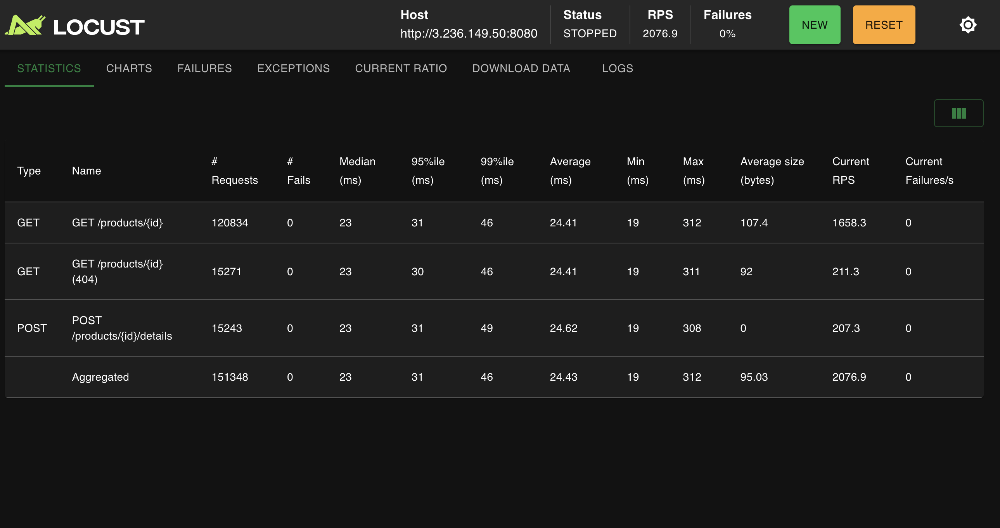

**100 users**


**200 users**


**500 users**

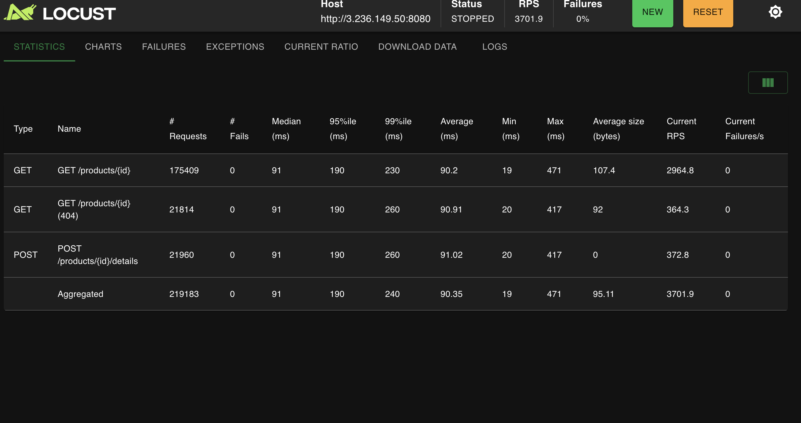

**1000 users (stress test, spawn rate 25/s)**

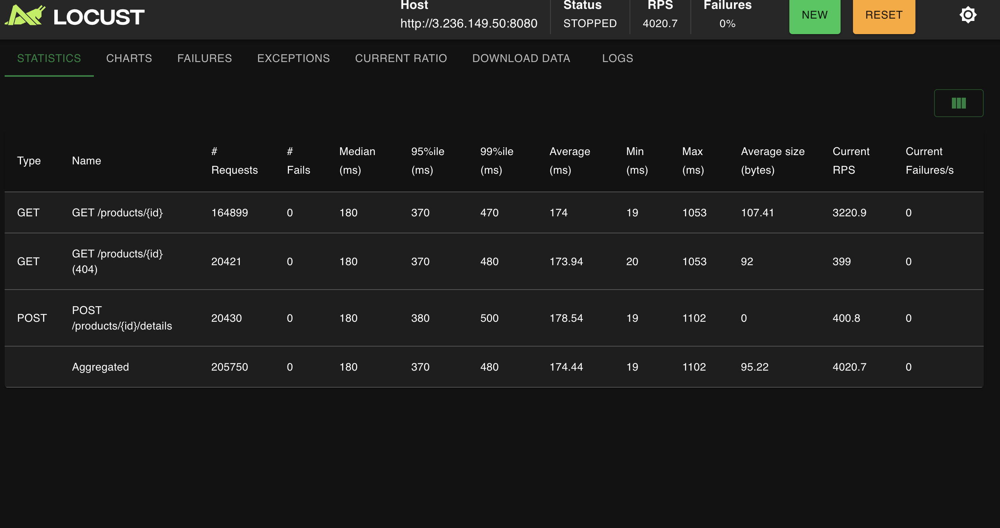

**Charts for the whole series.** The charts show every run on one timeline: requests per second, p50/p95 response time, and number of users. The 1000-user run is the stress test.

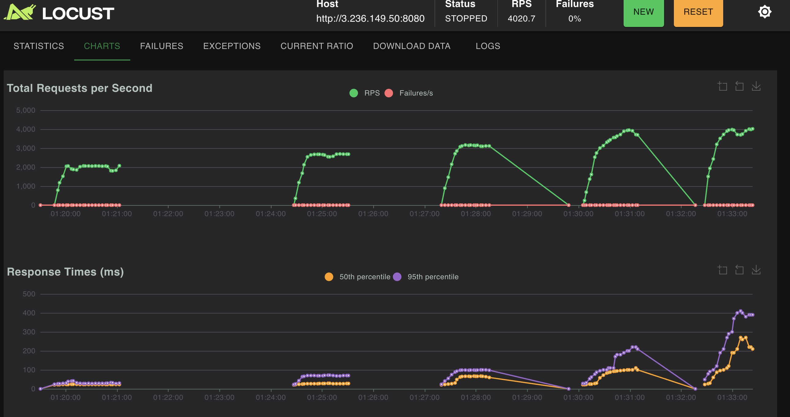

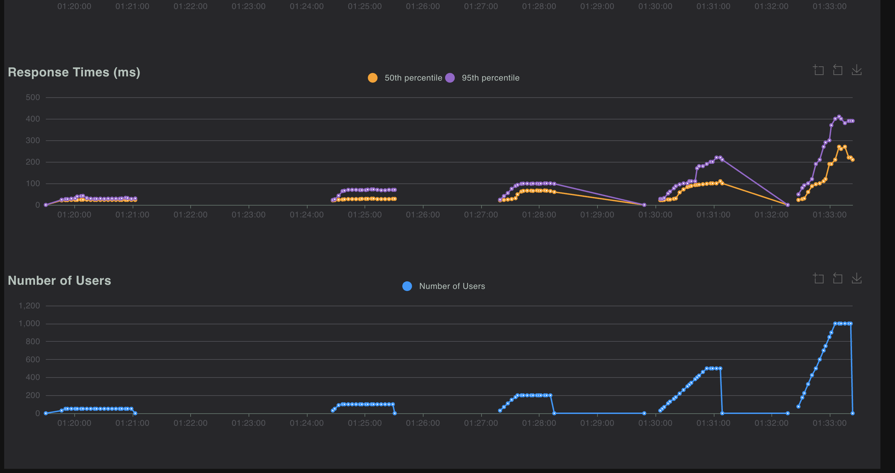

<details>
<summary>Charts captured after each earlier level</summary>

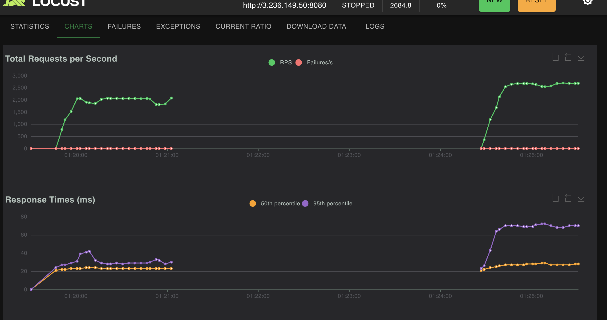
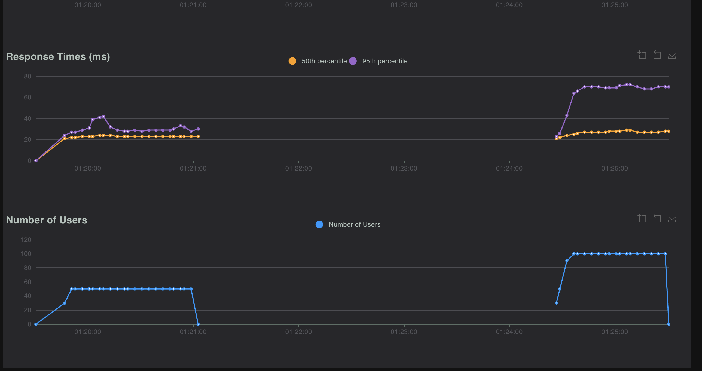
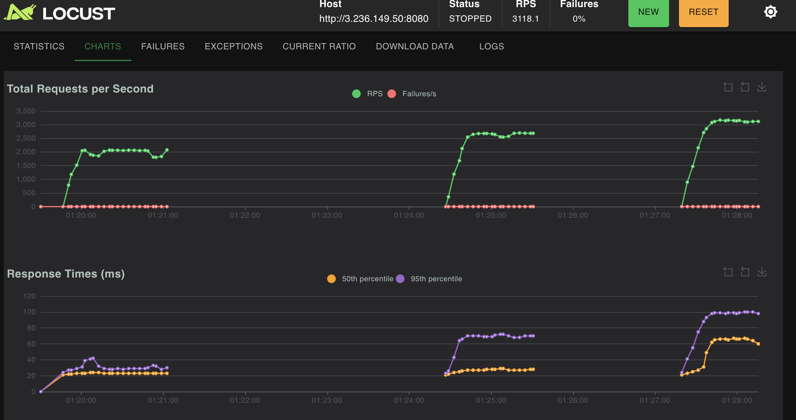
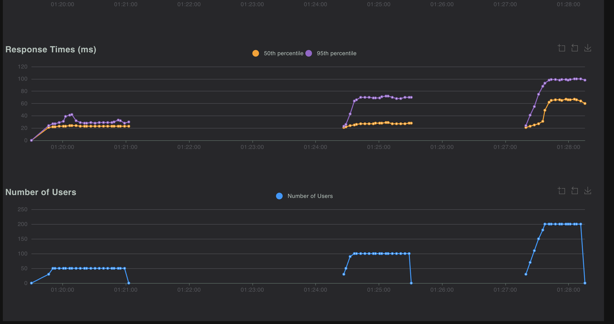
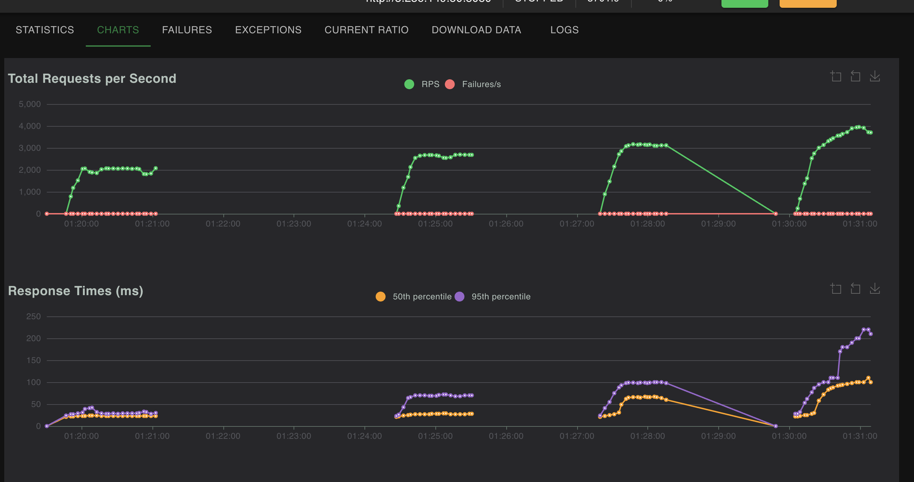
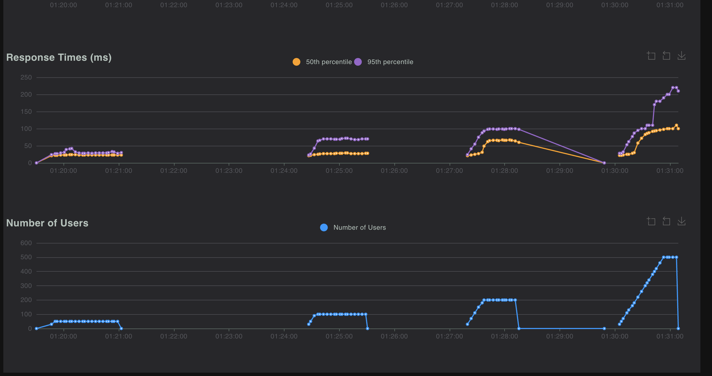

</details>

### Where the server struggled
- Nothing failed: 0 errors up to 1000 users. The server degraded through latency, not errors.
- The tail got worse first: going from 50 to 100 users, p95 more than doubled (31 to 69 ms) while the median barely moved.
- From 200 to 1000 users (5x), throughput rose only 29% (3,118 to 4,021 RPS) while the median went from 56 to 180 ms. Extra users just queue.
- **Cause: the Fargate task's CPU (0.25 vCPU).** CloudWatch `CPUUtilization` at 1-minute resolution reached 94-100% in every run from 50 users up (for example about 96% around 01:17, during the HttpUser 50-user run, and 99.7% during the 500-user run). Memory peaked at about 6% and the task count stayed at 1, so the task did not crash or restart (CloudWatch screenshots below).
- Note on the CPU screenshot below: the console graph defaults to a 5-minute average and ends before the 1000-user run, so it shows only about 41% at its peak. The short, saturated runs are averaged with idle time. The 1-minute data is what shows the plateau.
- **Not the client:** during the 1000-user run the Locust process used about 33% of one core (Activity Monitor), so the load generator was not the limit.
- About 22 ms of every latency is the network round trip from the laptop to AWS.

CloudWatch for the ECS service (console defaults, UTC, 5-minute average):


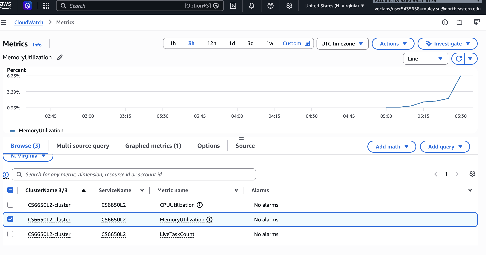

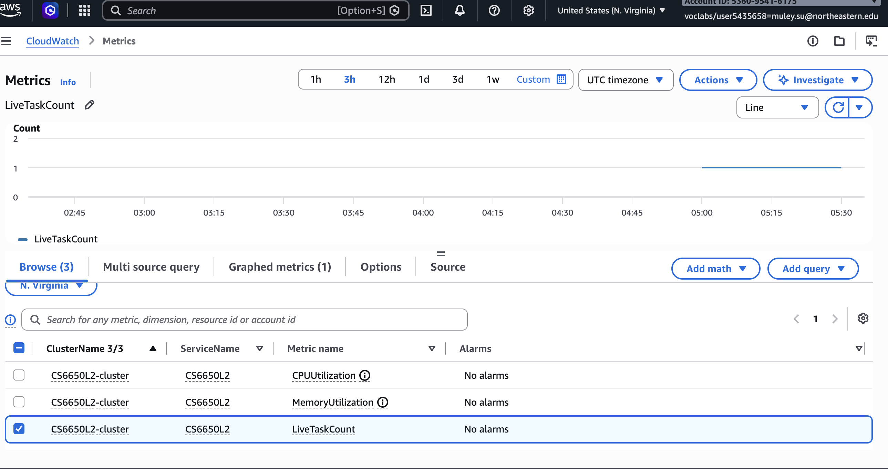

### Tradeoffs
- **Most common operation:** reads (`GET /products/{id}`). A shopper browses far more than a merchant updates products.
- **Effect on the data structure:** a `map` gives O(1) reads. A `sync.RWMutex` lets many GETs run in parallel and serializes only the POSTs, which suits a read-heavy mix. A plain `Mutex` would serialize the reads too, and no lock at all would be a data race (Go maps can crash on concurrent writes).
- **Limits:** the data lives in one task's memory, so it is lost on restart and cannot be shared across several tasks. A scalable design needs a database and a cache.

### HttpUser vs FastHttpUser (50 users)

| Client | RPS at end of run | Median | p95 | Failures |
|---|---|---|---|---|
| HttpUser | 1,859 | 24 ms | 31 ms | 0 |
| FastHttpUser | 2,077 | 23 ms | 31 ms | 0 |


**HttpUser, 50 users**


**FastHttpUser, 50 users**


FastHttpUser gave about 12% more throughput with the same latency. The difference is small because Locust users are closed-loop: each waits for a response before sending the next request, so throughput is about users divided by latency. Here latency is dominated by the network trip and a CPU-bound server, not by the client. `HttpUser` is built on the Python `requests` library, which does more work per call. `FastHttpUser` uses `geventhttpclient`, a lighter, faster HTTP client, so one Locust process can generate more load before its own CPU becomes the limit. We did not reach that limit at 50 users, so the gap here understates what FastHttpUser can do. The server's CPU limit mattered more than the choice of client.

## Observability

The server tracks the RED signals (Rate, Errors, Duration) for every endpoint in two ways. The Prometheus and Grafana stack runs **locally only** and is not deployed to AWS.

### How it works
- **Metrics:** a Gin middleware in `src/product-service.go` records, per request, `http_requests_total` (rate), `http_request_errors_total` (non-2xx responses) and the `http_request_duration_seconds` histogram (latency). They are exposed at `GET /metrics`. Labels use the route pattern (`/products/:productId`), not the raw URL, so the number of label values stays small.
- **Logs:** the same middleware prints one JSON line per request to stdout: time, method, endpoint, path, status, duration in ms and client IP. It replaces Gin's default plain-text logger.
- **Errors count every non-2xx response**, including expected 404s. The Locust mix deliberately sends about 10% requests for a missing product, so a healthy load test still shows an error rate near 10%.

### Run the local stack
```
docker compose up --build
# Apple Silicon (native arm64 image, avoids emulation):
TARGET_ARCH=arm64 docker compose up --build
```

| Service | URL |
|---|---|
| Product API | http://localhost:8080 (metrics at `/metrics`) |
| Prometheus | http://localhost:9090 |
| Grafana | http://localhost:3000 (anonymous access; open the dashboard **Product API - RED**) |

The Prometheus scrape config is `observability/prometheus/prometheus.yml` (every 5 s). Grafana's data source and dashboard are provisioned from `observability/grafana/`, so no manual setup is needed. The dashboard has one panel per signal: requests per second, % non-2xx errors, and p50/p95 latency, plus a requests-per-status panel.

### Generate load and capture evidence
```
cd locust
LOCUST_CLIENT=fast locust -f locustfile.py -H http://localhost:8080
```
View the logs from the same run:
```
docker compose logs app | grep '^app-1  | {'
```
Stop everything with `docker compose down`.

### Dashboard: idle vs loaded
Locust ran against the local stack: FastHttpUser, **200 users at a spawn rate of 10/s**, back-to-back requests, same request mix as Part IV, from about 02:03 to 02:05. The dashboard was idle before that.

**Grafana dashboard "Product API - RED": Rate, Errors and Duration panels (idle, then loaded)**

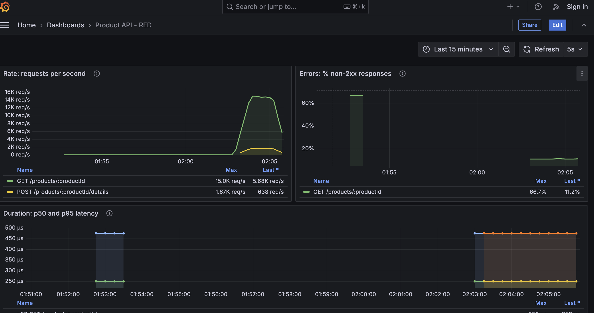

**Duration (with legend) and responses by status code**

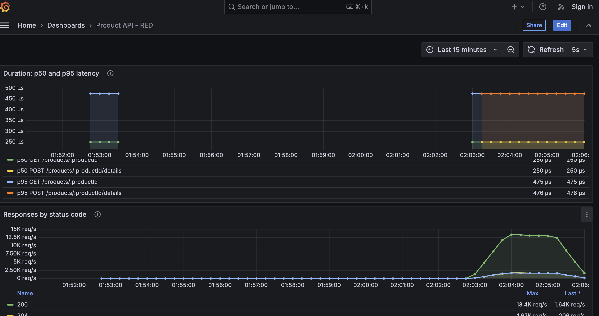

**Locust summary for the same run**


**Locust's own log for the run (shows the CPU warning described below)**

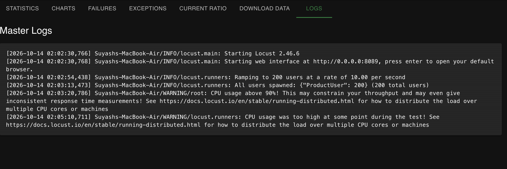

| | Idle | Loaded |
|---|---|---|
| Rate | 0 req/s | peak about 15.0K req/s GET and 1.67K req/s POST (Locust: 16,213 RPS at the end of the run, 2,276,850 requests, 0 failures) |
| Errors (% non-2xx) | none (see note) | about 11%: the deliberate `GET` of a missing product returns 404 on about 10% of requests |
| Duration, server side | none | p50 about 250 us, p95 about 475 us (see note) |
| Duration, as seen by Locust | n/a | median 7 ms, p95 11 ms, p99 12 ms |

Notes on reading the screenshots:
- **The earlier blip.** The short bar near 01:53 (66.7% errors, a latency bump) is from a few manual `curl` requests used to check the stack. Two of those three requests were deliberate errors, which is why the percentage is so high. It is not part of the load test.
- **The 250 us / 475 us lines are flat because of the histogram bucket resolution.** The smallest bucket is 0.5 ms and every request finished inside it, so `histogram_quantile` interpolates inside that one bucket (50% of 0.5 ms = 250 us, 95% = 475 us). The true latency is below 0.5 ms: the log lines show 0.015 to 0.45 ms, and the slowest request of the whole run was 5.8 ms. Finer buckets (for example 50 us and 100 us) would resolve it.
- **The load generator was the bottleneck in this run.** Locust logged `CPU usage above 90%` at 02:03:20 and `CPU usage was too high at some point during the test` at 02:05:10 (Locust log screenshot above). So the 16K RPS is a floor set by one Locust process on a laptop that was also running Docker, not the server's capacity, and Locust warns that it can give inconsistent response times. The server itself was not saturated: its own durations stayed under 0.5 ms (slowest request 5.8 ms).
- **Locust sees 7 ms and the server sees under 0.5 ms** because Locust's number includes client-side queueing at that CPU load, the Docker network and the load generator's own processing. It is not server time. Locust suggests distributing the load over several CPU cores (for example `--processes`) to remove this limit.
- **Local vs AWS:** the local server handled at least 16K RPS (limited by Locust, see above) with a 7 ms median, against about 4K RPS and a 180 ms median at 1000 users on the 0.25 vCPU Fargate task. The local run has no 22 ms network round trip, and the Fargate task was CPU-saturated while the local server was not. The two runs used different user counts (200 local, 50 to 1000 on AWS), so they are not a like-for-like comparison.

### Request log excerpt (same run)
One JSON object per request, from `docker compose logs app` during the Locust run (the screenshot below shows the same lines; the first lines in it, from 05:52, are manual test requests made before the load run):
```
{"time":"2026-10-14T06:02:54.444902678Z","method":"GET","endpoint":"/products/:productId","path":"/products/1","status":200,"duration_ms":0.398,"client_ip":"192.168.65.1"}
{"time":"2026-10-14T06:02:54.445007511Z","method":"POST","endpoint":"/products/:productId/details","path":"/products/1/details","status":204,"duration_ms":0.449,"client_ip":"192.168.65.1"}
{"time":"2026-10-14T06:02:54.445455011Z","method":"GET","endpoint":"/products/:productId","path":"/products/2","status":200,"duration_ms":0.024,"client_ip":"192.168.65.1"}
{"time":"2026-10-14T06:02:54.445832761Z","method":"GET","endpoint":"/products/:productId","path":"/products/999999","status":404,"duration_ms":0.054,"client_ip":"192.168.65.1"}
```
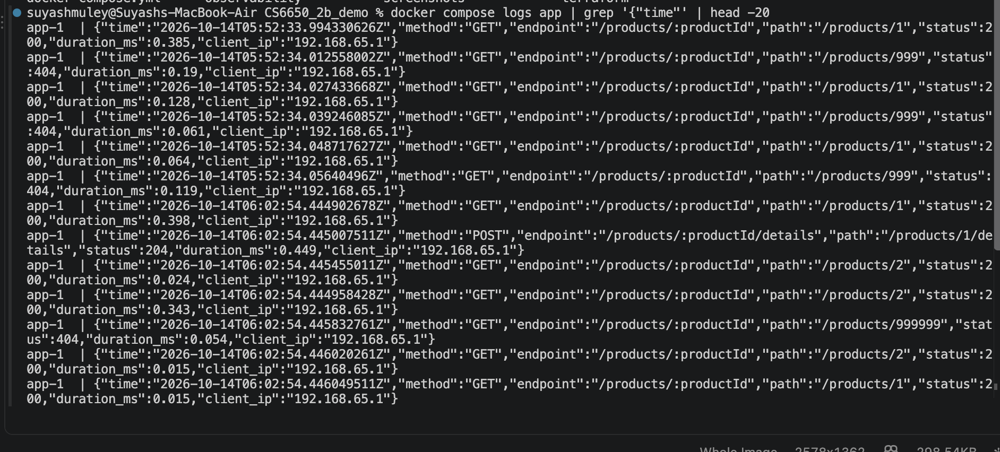

Over the whole run the server wrote 2,276,861 lines (1,820,996 x 200, 228,214 x 204, 227,651 x 404), which matches Locust's 2,276,850 requests plus a few manual test requests.

### When to use the dashboard vs the logs
Use the **dashboard** to watch the system live: it shows that something changed (rate up, errors or latency rising) as it happens, and how the three signals move together. Use the **logs** for after-the-fact debugging when nobody had Grafana open: they keep every individual request (path, status, duration), so you can find exactly which requests failed or were slow, which an aggregated metric cannot tell you.
